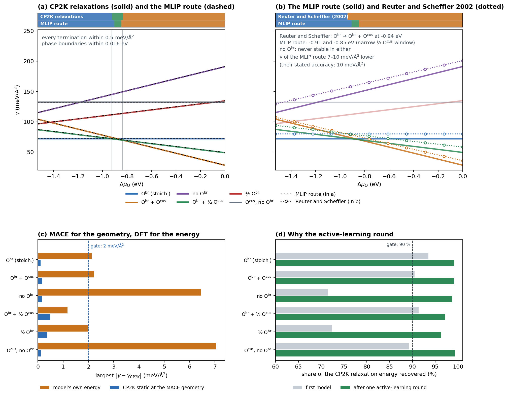

.. _mlip:

=====================================================
Relax terminations with a fine-tuned MACE model
=====================================================

Relaxing every termination with DFT limits how many terminations a study can
afford. The MLIP route of psteros replaces those relaxations: a few DFT
*static* calculations teach a MACE foundation model your system, the model
relaxes every slab on a GPU, and one more DFT static at each relaxed geometry
gives the energies of the surface phase diagram. In one line: **MACE finds the
relaxed geometry, DFT gives its energy.** Nothing in the existing workflows
changes when you do not use it.

.. figure:: ../images/mlip_route.png
   :width: 100%
   :alt: Flowchart of the MLIP route

   The MLIP route: DFT statics, a metal check, a replay fine-tune and a MACE
   relaxation on a GPU, one active-learning round, and the final DFT statics
   that enter the diagram.

.. warning::

   The route is for **metallic systems only** (metals, alloys, metallic
   oxides such as RuO\ :sub:`2`). ``require_metallic`` stops it when the bulk
   has no partly filled states at the Fermi level. Semiconductors and
   insulators need a separate treatment. The route was validated on
   RuO\ :sub:`2`\ (110) against full CP2K relaxations and Reuter and Scheffler,
   Phys. Rev. B 65, 035406 (2002), with gates fixed before the results (see
   ``docs/plans/MACE_SURFACE_PLAN.md`` and
   ``validation/ruo2_mace_lovelace/RESULTS.md``): with one active-learning
   round and one DFT static at each relaxed geometry (``"mlip_dft"``) every
   gate passed (surface energies within 0.5 meV/Å\ :sup:`2`, phase boundaries
   within 0.02 eV, 96-99 % of the DFT relaxation energy); the model's own
   energies (``"mlip"``) missed by 6-9 meV/Å\ :sup:`2`. Use ``"mlip_dft"``.

The recipe
----------

1. **Relax the references with DFT, once**: the bulk, the metal and the gas
   molecule in a box, with the recipe of the study. Cut the slabs at the
   relaxed bulk cell and do not relax them.
2. **One DFT static of every structure** (bulk, references, slabs as built):
   energies and forces, the training labels.
3. **Check that the bulk is a metal**; the graph stops otherwise.
4. **Replay fine-tune of MACE-MH-1** on a GPU: a new head learns the DFT
   labels while the original head keeps training on the foundation model's
   own labels of ~150 small structures of the same elements, so the model does
   not forget general chemistry.
5. **MACE relaxes every structure**, cell fixed, slab centre held in place.
6. **One active-learning round**: one DFT static at each relaxed geometry
   joins the labels, the model is fine-tuned again from MH-1 on all of them
   and relaxes the slabs again from the start. The first model has only seen
   unrelaxed slabs and stops short of the minimum on some terminations.
7. **One final DFT static at each relaxed geometry**; these energies, for the
   slabs and the references alike, enter the diagram.

That is three DFT statics per termination instead of a DFT relaxation.

Run it: ``MlipSurfaceStudy``
----------------------------

.. code-block:: python

   import psteros
   from aiida import orm

   study = psteros.MlipSurfaceStudy(bulk, {"Ru": ru_metal, "O": o2_box}, slabs)
   print(study)      # labels, fixed sites, number of DFT statics and GPU jobs

   static = psteros.SurfaceWorkflowConfig(backend="cp2k", name="ruo2", calculation=cp2k_recipe,
                                          execution=cpu_execution, role_overrides={"ref_O": triplet_o2})
   fine_tune = psteros.MaceFineTuneConfig("/work/me/models/mace-mh-1.model",
                                          replay_file="replay-data-mh-1-omat-pbe.xyz")
   job = psteros.MlipJobConfig("mace-python@gpu-cluster", psteros.ExecutionPolicy(
       queue="gpu", with_mpi=False, max_wallclock_seconds=6 * 3600,
       resources={"num_machines": 1, "num_mpiprocs_per_machine": 8, "ngpus_per_machine": 1}))
   graph = study.build(static, fine_tune, job=job, submit=True)

   result = study.analyse(orm.load_node(graph.pk))   # the final DFT energies only
   print(result)
   result.diagram.plot("ruo2_110_mlip.png")

``MlipSurfaceStudy(bulk, references, slabs, fixed_half_width_angstrom=1.5,
rattled=0)`` labels the calculations ``bulk``, ``ref_<element>`` and the slab
labels; it keeps the sites within ``fixed_half_width_angstrom`` of each slab
mid-plane in place during the MACE relaxations and adds ``rattled`` rattled
copies of each slab to the training statics. ``analyse`` also takes a mapping
of energies typed by hand. A full script is
``examples/mlip_ruo2/ruo2_mlip_graph.py``; the guide with the validation is
``docs/MLIP_SURFACES.md``.

Validation on RuO\ :sub:`2`\ (110)
----------------------------------

   (a) Surface energies from full CP2K relaxations (solid) and from the MLIP
   route (dashed). (b) The MLIP route (solid) against Fig. 3 of Reuter and
   Scheffler (dotted, read from the vector graphics of arXiv:cond-mat/0107229):
   the same stable terminations, the boundary at -0.94 eV for them and -0.91
   to -0.85 eV here, surface energies 8-10 meV/Å\ :sup:`2` lower, within
   their stated accuracy of 10 meV/Å\ :sup:`2`. (c) Largest error of each
   termination with the model's own energies and with a CP2K static at the
   MACE geometry. (d) Share of the CP2K relaxation energy recovered by the
   MACE relaxation, before and after the active-learning round.

Training longer (500 passes with a decaying learning rate) did not replace the
active-learning round: the relaxations of two terminations still stopped at
72-77 % of the DFT relaxation. Five rattled copies per slab in the first
training set (``rattled=5`` with ``active_learning_rounds=0``) also passed the
gates, for 80 % of the DFT time of the relaxations instead of 34 %.

One energy source per diagram
-----------------------------

With

.. math::

   \gamma = \frac{1}{nA}\Big[E_\mathrm{slab} - \sum_i N_i\,\mu_i\Big],
   \qquad \mu_i = E_i^\mathrm{ref} + \Delta\mu_i ,

adding a constant :math:`\delta_Z` per atom of element :math:`Z` to every energy
changes :math:`\gamma` by :math:`\sum_Z N_Z \delta_Z - \sum_Z N_Z \delta_Z = 0`, but
only if the slab and every reference carry the same :math:`\delta_Z`: they must
come from the same model, or the same DFT. A model's slab energy with a DFT
bulk energy brings the offsets straight into :math:`\gamma`.
``check_one_energy_source`` raises a ``ValueError`` that names the labels of
each source (``"dft"``, ``"mlip"``, ``"mlip_dft"``). The same identity makes the
E0s of the fine-tuned head irrelevant for :math:`\gamma`; ``fit_element_shifts``
only makes the fit start close.

The building blocks (job folders, no AiiDA)
--------------------------------------------

1. **Labels.** DFT static calculations (for example with
   :doc:`cp2k-workflow`) of the bulk, the elemental references, the gas
   molecule and every termination as built, each a ``LabelledStructure``
   (energy in eV, forces in eV/Å). With smearing, use the free energy, whose
   derivatives are the forces.
2. **Fine-tune.** ``MaceFineTuneConfig`` holds the recipe (default: MACE-MH-1,
   head ``omat_pbe``, float64, batch 1, constant learning rate 1e-3, EMA
   0.999, universal loss with energy and force weights 10, 100 passes, the
   final EMA model). With ``replay=True`` it is a multi-head replay fine-tune:
   ``select_replay_structures`` picks from the foundation model's replay data
   every distinct structure made only of the training elements;
   ``prepare_finetune_job`` writes a job folder (``job.json``, the labels,
   the replay geometries and the script ``finetune.py``) to run on the GPU
   computer, one model per seed. The job labels the replay structures with
   the foundation model, fits the E0 shifts, checks that the untrained model
   reproduces the foundation model, trains and evaluates both heads.
3. **Relax.** ``prepare_relax_job`` writes a folder in which every model
   relaxes every structure with ASE (``relax.py``; positions only, fixed sites
   kept, ``MlipRelaxConfig``: FIRE to 0.01 eV/Å by default).
   ``relax_with_calculator`` does the same in Python with any ASE calculator.
4. **Diagram.** Type the energies into ``SlabTermination`` and the reference
   classes of :doc:`phase-diagram`, all from one source.

.. code-block:: python

   import psteros

   config = psteros.MaceFineTuneConfig(
       "/work/me/models/mace-mh-1.model",
       foundation_model_sha256="a522eb7f59c7879963d41586528f4980baf33e086c94aa92e3eafdeccad3be47",
       replay_file="replay-data-mh-1-omat-pbe.xyz",
   )
   train, valid, record = psteros.select_replay_structures(config.replay_file, elements=["Ru", "O"])
   folder = psteros.prepare_finetune_job("jobs/ruo2_m2", frames, config, name="ruo2_m2",
                                         replay_train=train, replay_valid=valid)
   # run "python finetune.py" in that folder on a GPU node, then:
   models = {f"m2_{seed}": (f"jobs/ruo2_m2/models/ruo2_m2_seed{seed}.model", "Default") for seed in config.seeds}
   psteros.prepare_relax_job("jobs/ruo2_relax", slabs, models,
                             fixed_sites={label: psteros.central_sites(slab) for label, slab in slabs.items()})

``rutile_110_slab`` builds the six RuO\ :sub:`2`\ (110) terminations of the
validation (``RUTILE_110_TERMINATIONS``) for any rutile MO\ :sub:`2`.

The whole route as one WorkGraph
--------------------------------

``build_mlip_surface_workgraph`` wires the validated route for QE, VASP or
CP2K statics and a GPU computer with a MACE environment:

1. one DFT static of every structure (slabs and references, the references
   already relaxed with the same recipe) and of the optional
   ``training_structures`` (for example ``rattled_copies`` of the slabs);
2. a replay fine-tune (``MaceFineTuneConfig``) on those labels, after checking
   that ``metallic_bulk`` is a metal;
3. the model of the first seed relaxes every structure (cell fixed,
   ``fixed_sites`` kept in place); the other seeds relax them too, as a
   committee in ``mlip_round<r>_relax_results``;
4. ``active_learning_rounds`` times (1 by default, as validated): one DFT
   static at each relaxed geometry joins the labels, a new fine-tune from the
   foundation model trains on all of them, and the new model relaxes the
   structures again from the start;
5. with ``dft_check`` (default), one DFT static at each final geometry.

Every task is wired when the graph is built; calcfunctions only turn finished
calculations into the next job's inputs (the training folder, the relaxed
structure). The fine-tune and relaxation jobs are aiida-shell jobs that run
``finetune.py`` and ``relax.py`` with the Python of ``MlipJobConfig.code_label``;
a relaxation links the remote folder of its fine-tune, so both run on that
computer and the folder, which holds the models, is never cleaned. A
relaxation that does not reach ``fmax`` stops the graph instead of sending an
unrelaxed geometry to DFT.

.. code-block:: python

   import psteros

   static = psteros.SurfaceWorkflowConfig(backend="cp2k", name="ruo2", calculation=cp2k_recipe,
                                          execution=cpu_execution, role_overrides={"o2": triplet})
   fine_tune = psteros.MaceFineTuneConfig("/work/me/models/mace-mh-1.model",
                                          replay_file="replay-data-mh-1-omat-pbe.xyz")
   job = psteros.MlipJobConfig("mace-python@gpu-cluster", psteros.ExecutionPolicy(
       queue="gpu", with_mpi=False, max_wallclock_seconds=6 * 3600,
       resources={"num_machines": 1, "num_mpiprocs_per_machine": 8, "ngpus_per_machine": 1}))
   graph = psteros.build_mlip_surface_workgraph(
       structures, static, fine_tune, job=job, metallic_bulk="bulk",
       fixed_sites={label: psteros.central_sites(structures[label]) for label in slabs}, submit=True)
   # when it has finished (or while it runs, for the parts that have):
   energies = psteros.read_mlip_energies(graph_node, list(structures), energy_source="mlip_dft")
   relaxations = psteros.read_mlip_results(graph_node, list(structures))

The energies of ``read_mlip_energies`` all come from one source, so the slabs
and the references go into one diagram. For RuO\ :sub:`2`\ (110) the route
needed three DFT statics per termination (start, active learning, check), 34 %
of the CP2K time of relaxing and re-computing them; the saving grows with the
number of relaxation steps, which the route does not pay for.
