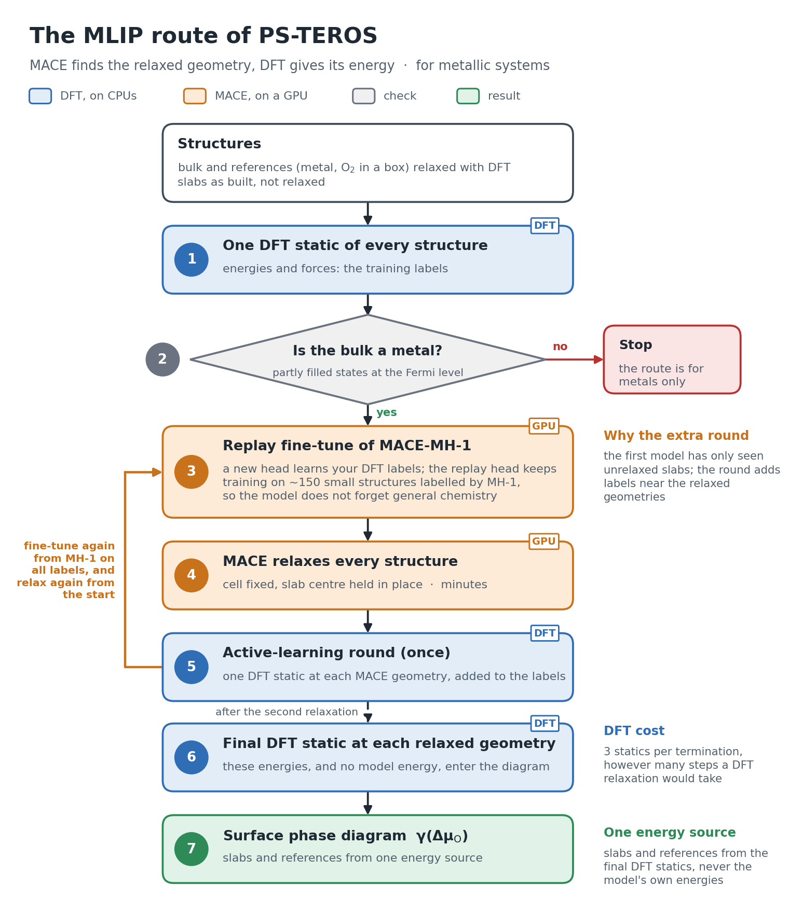

.. _mlip:

=====================================================
Relax terminations with a fine-tuned MACE model
=====================================================

Relaxing every termination with DFT limits how many terminations a study can
afford. The MLIP route of psteros replaces those relaxations: a few DFT
*static* calculations teach a MACE foundation model your system, the model
relaxes every slab on a GPU, and one more DFT static at each relaxed geometry
gives the energies of the surface phase diagram. In one line: **MACE finds the
relaxed geometry, DFT gives its energy.**

It is the route psteros recommends when you have a GPU: the slab relaxations,
usually the bottleneck of a study, cost minutes on the GPU instead of DFT
hours, so a study can afford many more terminations. Without a GPU, relax the
slabs with DFT as before (:doc:`vasp-workflow`, :doc:`qe-workflow`,
:doc:`cp2k-workflow`); nothing in those workflows changes.

   The MLIP route: DFT statics, the electron-count check, a replay fine-tune
   and a MACE relaxation on a GPU, one active-learning round, the final DFT
   statics that enter the diagram and, optionally, the model's vibrations.

.. warning::

   Converge the DFT recipe for your system and check a new system against a
   few DFT relaxations before relying on the route. Use the final DFT
   energies (``"mlip_dft"``), not the model's own (``"mlip"``).

Metals, semiconductors and insulators
-------------------------------------

The route itself does not care whether the compound is a metal. The slabs do:
in a metal any cut of the bulk has a sensible electron count, but a slab of a
semiconductor or an insulator must be charge-neutral, or passivated, which
pymatgen's ``SlabGenerator`` alone does not ensure. So psteros asks for one of
two things:

* **Slabs cut by psteros** with electron counting:
  ``MlipRoute(ChargeNeutralSurfaceStudy(...))`` (symmetric, charge-neutral
  slabs of an element, a binary or a ternary compound) or
  ``MlipRoute(PolarSurfaceStudy(...))`` (polar faces on a pseudo-hydrogen
  passivated bottom); see :ref:`mlip-route-studies`. These run for any
  compound, with no metal check.
* **Your own slabs** (``MlipSurfaceStudy``, ``build_mlip_surface_workgraph``):
  the graph checks that the bulk is a metal (partly filled states at the
  Fermi level, ``require_metallic``) and stops otherwise. With
  ``allow_non_metallic=True`` it runs anyway and warns you that the electron
  count of the slabs is then your responsibility.

The recipe
----------

1. **Relax the references with DFT, once**: the bulk, the metal and the gas
   molecule in a box, with the recipe of the study. Cut the slabs at the
   relaxed bulk cell and do not relax them.
2. **One DFT static of every structure** (bulk, references, slabs as built):
   energies and forces, the training labels.
3. **Check the electron count**: slabs cut by psteros pass; your own slabs
   need a metallic bulk (or ``allow_non_metallic=True``).
4. **Replay fine-tune of MACE-MH-1** on a GPU: a new head learns the DFT
   labels while the original head keeps training on the foundation model's
   own labels of ~150 small structures of the same elements, so the model does
   not forget general chemistry.
5. **MACE relaxes every structure**, cell fixed, slab centre held in place.
6. **One active-learning round**: one DFT static at each relaxed geometry
   joins the labels, the model is fine-tuned again from MH-1 on all of them
   and relaxes the slabs again from the start. The first model has only seen
   unrelaxed slabs; these statics add labels near the relaxed geometries.
7. **One final DFT static at each relaxed geometry**; these energies, for the
   slabs and the references alike, enter the diagram.

That is three DFT statics per termination instead of a DFT relaxation.
Optionally, the final model also gives the harmonic vibrations of every
structure (see :ref:`mlip-vibrations`).

Run it: ``MlipSurfaceStudy``
----------------------------

.. code-block:: python

   import psteros
   from aiida import orm

   study = psteros.MlipSurfaceStudy(bulk, {"Ru": ru_metal, "O": o2_box}, slabs)
   print(study)      # labels, fixed sites, number of DFT statics and GPU jobs

   static = psteros.SurfaceWorkflowConfig(backend="cp2k", name="ruo2", calculation=cp2k_recipe,
                                          execution=cpu_execution, role_overrides={"ref_O": triplet_o2})
   fine_tune = psteros.MaceFineTuneConfig("/work/me/models/mace-mh-1.model",
                                          replay_file="replay-data-mh-1-omat-pbe.xyz")
   job = psteros.MlipJobConfig("mace-python@gpu-cluster", psteros.ExecutionPolicy(
       queue="gpu", with_mpi=False, max_wallclock_seconds=6 * 3600,
       resources={"num_machines": 1, "num_mpiprocs_per_machine": 8, "ngpus_per_machine": 1}))
   graph = study.build(static, fine_tune, job=job, submit=True)

   result = study.analyse(orm.load_node(graph.pk))   # the final DFT energies only
   print(result)
   result.diagram.plot("ruo2_110_mlip.png")

``MlipSurfaceStudy(bulk, references, slabs, fixed_half_width_angstrom=1.5,
rattled=0)`` labels the calculations ``bulk``, ``ref_<element>`` and the slab
labels; it keeps the sites within ``fixed_half_width_angstrom`` of each slab
mid-plane in place during the MACE relaxations and adds ``rattled`` rattled
copies of each slab to the training statics. ``analyse`` also takes a mapping
of energies typed by hand. A full script is
``examples/mlip_ruo2/ruo2_mlip_graph.py``; the guide is
``docs/MLIP_SURFACES.md``.

Instead of the active-learning round, ``rattled=5`` adds five rattled copies
of each slab to the first training set; with ``active_learning_rounds=0`` one
fine-tune then runs, with more DFT statics up front.

.. _mlip-route-studies:

Run it: ``MlipRoute`` with the studies of psteros
-------------------------------------------------

``MlipRoute(study)`` runs a ``ChargeNeutralSurfaceStudy`` or a
``PolarSurfaceStudy`` on the MLIP route. The study cuts the slabs (one or
more orientations, any number of elements) and keeps its labels, its settings
and its analysis; the route replaces the DFT relaxations:

.. code-block:: python

   study = psteros.ChargeNeutralSurfaceStudy(
       sno2_bulk, [(1, 1, 0), (1, 0, 0)], references={"Sn": tin, "O": psteros.triplet_o2_cell()})
   route = psteros.MlipRoute(study)        # the centre of each slab held in place, as above
   print(route)                            # slabs, fixed sites, DFT statics and GPU jobs

   static = psteros.SurfaceWorkflowConfig(
       backend="vasp", name="sno2", execution=cpu_execution,
       calculation=psteros.VaspCalculationConfig(
           "vasp@cpu-cluster", incar={"ENCUT": 520, "EDIFF": 1e-6, "ISMEAR": 0, "SIGMA": 0.05,
                                      "IBRION": -1, "NSW": 0, "LREAL": False}),
       role_overrides=study.vasp_overrides("static"))
   graph = route.build(static, fine_tune, job=job, submit=True)

   result = route.analyse(orm.load_node(graph.pk))   # the study's own analysis, on the final DFT energies
   result.diagram.plot("sno2_mlip.png")

``route.read(graph)`` gives the energies and the MACE-relaxed structures, the
same pair as ``read_vasp_results``. A ternary study gives a
``TernarySurfacePhaseDiagram``, an element its surface energies.

**Polar surfaces.** ``MlipRoute(PolarSurfaceStudy(...))`` runs the polar
faces with VASP (the pseudo-hydrogen POTCARs); use
``study.potential_mapping(...)`` and ``study.vasp_overrides("static")`` in the
static recipe. Every atom of a polar slab relaxes, as in the polar method, and
``analyse`` returns the ``PolarStudyResult`` with the bottom check of the
MACE-relaxed slabs. For the model the pseudo-hydrogens are hydrogen atoms
(the models see elements, not kinds); the fine-tune learns them from their DFT
labels. Each pseudo-hydrogen kind passivates one element (on GaAs, ``H0p75``
the As atoms and ``H1p25`` the Ga atoms), so the model tells the kinds apart
by their neighbour. The replay structures of such a study hold no hydrogen:
their foundation labels would teach the same species the chemistry of real
hydrogen. For the same reason a study may not hold hydrogen and
pseudo-hydrogens together (both would be ``H`` in the same environments): the
builders refuse it with a ``ValueError`` naming the labels and their kinds;
run such a study with the DFT route.

.. _mlip-foundation-models:

Choosing the foundation model
-----------------------------

The route fine-tunes any MACE model file, MACE-MH-1 by default.
``psteros.MACE_FOUNDATION_MODELS`` lists the released models that have been
run through the route's fine-tune and relaxation jobs (every head below, with
mace-torch 0.3.16), with the DFT each head was trained on:

.. list-table::
   :header-rows: 1
   :widths: 22 22 18 8 30

   * - ``name``
     - heads for solids and slabs
     - trained on
     - licence
     - use it when
   * - ``mace-mh-1``
     - ``omat_pbe`` (default), ``mp_pbe_refit_add``, ``oc20_usemppbe``,
       ``matpes_r2scan``
     - PBE/PBE+U (OMat24, MPtrj), PBE (OC20), r2SCAN (MatPES)
     - ASL
     - the default: one model for bulk, surfaces and molecules
   * - ``mace-omat-0-medium``, ``mace-omat-0-small``
     - ``default``, ``omat_pbe``
     - PBE/PBE+U (OMat24)
     - ASL
     - a single-head model; ``small`` is faster for large slabs
   * - ``mace-matpes-pbe-0``
     - ``default``
     - PBE without +U (MatPES)
     - ASL
     - your DFT has no +U on transition-metal oxides
   * - ``mace-matpes-r2scan-0``
     - ``default``
     - r2SCAN (MatPES)
     - ASL
     - your DFT is r2SCAN (or use ``mace-mh-1``, head ``matpes_r2scan``)
   * - ``mace-mpa-0-medium``
     - ``default``
     - PBE/PBE+U (MPtrj, sAlex)
     - MIT
     - you need an MIT-licensed model
   * - ``mace-mp-0b3-medium``, ``mace-mp-0-medium``
     - ``default``, ``Default``
     - PBE/PBE+U (MPtrj)
     - MIT
     - comparison with earlier work; weak on surfaces before fine-tuning

``MaceFineTuneConfig.for_foundation(name, path, head=None, **options)`` builds
the recipe of one of them: the model's default head unless ``head`` is given,
and the release's checksum, which the job checks before training:

.. code-block:: python

   model = psteros.mace_foundation_model("mace-matpes-r2scan-0")
   print(model.url, model.replay_url)   # download both; the model goes to the GPU computer
   fine_tune = psteros.MaceFineTuneConfig.for_foundation(
       "mace-matpes-r2scan-0", "/work/me/models/" + model.filename,
       replay_file="matpes-r2scan-replay-data.extxyz")

**Match the level of theory of your DFT.** The fine-tune fits one energy
shift per element between your DFT and the model, which absorbs constant
offsets (pseudopotentials, reference energies) but not a different functional
or a different +U scheme; those the fine-tune must learn from your few labels.
So with a named model (``for_foundation`` or ``foundation_name=...``) the
builders warn (``psteros.foundation_level_warnings``) when:

* the functional of the DFT recipe differs from the head's (read from the
  recipe by ``psteros.recipe_level_of_theory``: VASP ``GGA``/``METAGGA``/
  ``LHFCALC`` and the POTCAR family, QE ``input_dft`` or the pseudopotential
  family, CP2K ``XC_FUNCTIONAL``), naming the heads trained on yours;
* the head was trained with the Materials Project +U (on Co, Cr, Fe, Mn, Mo,
  Ni, V or W in oxides and fluorides), the study has such an oxide or
  fluoride and the recipe has no +U, or the head was trained without +U and
  the recipe uses it;
* the head was trained on molecules only (``omol``, ``spice_wB97M`` of
  MACE-MH-1).

A recipe whose functional cannot be read gives no warning. A different level
of theory is allowed (fine-tuning across functionals works), the warning only
tells you that the model starts further away.

**Replay data.** The job relabels the replay geometries with the foundation
model itself, so any replay file works with any model; ``model.replay_url``
is the one of the model's release (the structures it was trained on).

**Head names** are those of the model files, which do not always match the
model cards: most single-head models call their head ``default``, MACE-OMAT-0
small ``omat_pbe``, and MACE calls the head of the 2023 MACE-MP-0 file, which
has none, ``Default``. The MACE-MH-1 file has ``mp_pbe_refit_add`` and no
``rgd1_b3lyp`` head. A recipe without ``foundation_name`` is not checked, as
before: any MACE model file and head work.

In a zero-shot benchmark of cleavage energies (fixed DFT geometries,
metallic compounds; `arXiv:2508.21663 <https://arxiv.org/abs/2508.21663>`_)
the models trained on OMat24 do best among the MACE models (MACE-OMAT 7.8 %
mean absolute percentage error, MACE-MPA 9.7 %, MACE-MP-0b3 25.2 %). After
fine-tuning such differences shrink; choose by the level of theory first.

.. _mlip-error-bars:

Error bars on gamma
-------------------

The model relaxes every structure and one DFT static at that geometry gives
its energy; the DFT minimum is a little lower. ``relaxation_estimate=True``
in ``build`` (and in ``build_mlip_surface_workgraph``) adds one GPU job with
the deployed model's Hessian ``H`` at the final geometries, over the atoms
that relax. With the DFT forces ``F`` of the final statics it gives, for every
structure, the quasi-Newton step ``H^-1 F`` towards the DFT minimum and the
energy that a DFT relaxation would still lose,

``dE = -1/2 F^T H^-1 F``  (eV, <= 0; exact for a quadratic energy surface).

The zero modes are left out (3 translations of a periodic cell whose every
atom relaxes, 5 or 6 for a molecule), and so is every mode softer than
``min_curvature_ev_per_angstrom2`` (0.05 eV/A^2) or negative (a saddle point
of the model); the force on them is reported. ``route.gamma_error_bars(graph)``
lowers every structure (slabs, bulk, references) by its ``dE``, draws the
diagram again and returns, per termination, the change of gamma
(``GammaErrorBar``, usually negative): the error that the model's geometry
puts on that gamma.

.. code-block:: python

   graph = route.build(static, fine_tune, job=job, relaxation_estimate=True, submit=True)
   # when it has finished
   for bar in route.gamma_error_bars(orm.load_node(graph.pk)).values():
       print(bar.summary())   # per slab: d gamma (meV/A2), dE (meV), largest DFT force and step

An estimate is ``reliable`` when no mode was negative, the force on the
left-out modes is at most 0.05 eV/A and no atom would move more than 0.1 A;
beyond that the quadratic model is not to be trusted and the structure needs
another active-learning round or a DFT relaxation. ``read_relaxation_estimates``
gives the estimates of a graph, ``relaxation_estimate`` the estimate of any
forces and Hessian (``hessian_from_forces`` builds a Hessian from displaced
forces).

.. _mlip-uma:

UMA (fairchem) instead of MACE
------------------------------

The route also runs on Meta's UMA models (fairchem): give a
``psteros.UmaFineTuneConfig`` where a ``MaceFineTuneConfig`` goes, and an
``MlipJobConfig`` whose code is the Python of a fairchem environment on the
GPU computer (``fairchem-core``, Python 3.11 or later). Everything else (the
DFT statics, the active-learning round, the relaxations, the vibrations, the
one-energy-source rule and the analysis) is the same:

.. code-block:: python

   model = psteros.uma_foundation_model("uma-s-1p2p1")
   print(model.url)                      # gated: accept the licence on Hugging Face, then download
   fine_tune = psteros.UmaFineTuneConfig.for_foundation(
       "uma-s-1p2p1", "/work/me/models/uma-s-1p2p1.pt",
       replay_file="replay-data-mh-1-omat-pbe.xyz", epochs=20)
   job = psteros.MlipJobConfig("uma-python@gpu-cluster", gpu_execution)
   graph = route.build(static, fine_tune, job=job, submit=True)

``UmaFineTuneConfig(foundation_model, foundation_model_sha256=None,
task="omat", replay=True, replay_file=None, ..., epochs=20,
learning_rate=1e-4, weight_decay=1e-3, batch_size=2, energy_weight=20.0,
forces_weight=2.0, ema_decay=0.999, seeds=(20260920,), foundation_name=None)``:
``task`` is the UMA task the fine-tune starts from (``"omat"``, inorganic
materials at PBE/PBE+U, for slabs), and the deployed model runs that task.

**How the job fine-tunes UMA.** fairchem's own fine-tune starts from the raw
(not the averaged) weights of the backbone, builds a new energy head from
random weights and fits new element references, so its starting model is
not the foundation model. The psteros job (``uma_finetune.py``) instead
starts from the averaged weights that fairchem's inference uses, merges
UMA's per-task head on ``task`` and copies it into the new head, keeps the
foundation's normalizer and sets the element references of the task plus one
shift per element (fitted to E_DFT − E_UMA over the training frames, as for
MACE). A first pass at a zero learning rate checks,
through the same checkpoint the training writes, that this model reproduces
the foundation model (shifted) on a training frame and a replay structure.
Then the training proper runs with the replay structures labelled by the
foundation model (with the same shifts) among the DFT frames, so the model is
pulled towards your DFT without forgetting the foundation elsewhere.

``fairchem`` keeps an exponential moving average of the weights (``ema_decay``)
and its inference loads that average; with few training steps a decay close to
1 leaves the model near the foundation, so keep ``epochs × frames /
batch_size`` well above ``1 / (1 − ema_decay)``.

.. _mlip-nequip:

NequIP and Allegro instead of MACE
----------------------------------

The route also runs on the foundation models of the NequIP framework
(nequip.net, CC BY 4.0): give a ``psteros.NequipFineTuneConfig`` and an
``MlipJobConfig`` whose code is the Python of an environment with ``nequip``
(and ``nequip-allegro`` for Allegro models) on the GPU computer:

.. code-block:: python

   model = psteros.nequip_foundation_model("nequip-oam-l")
   print(model.download)    # nequip.net:mir-group/NequIP-OAM-L:0.1
   fine_tune = psteros.NequipFineTuneConfig.for_foundation(
       "nequip-oam-l", "/work/me/models/NequIP-OAM-L-0.1.nequip.zip",
       replay_file="replay-data-mh-1-omat-pbe.xyz", epochs=30)
   job = psteros.MlipJobConfig("nequip-python@gpu-cluster", gpu_execution)
   graph = route.build(static, fine_tune, job=job, submit=True)

``psteros.NEQUIP_FOUNDATION_MODELS`` lists ``nequip-oam-s``, ``-m``, ``-l``,
``-xl`` and ``allegro-oam-l`` (all trained on OMat24, then sAlex and MPtrj:
PBE/PBE+U). Download a package once on a computer with internet, for
example with ``python -c "from nequip.model.saved_models.load_utils import
load_saved_model; load_saved_model('nequip.net:mir-group/NequIP-OAM-L:0.1')"``
(it lands in ``~/.nequip/model_cache``, or ``$NEQUIP_CACHE_DIR``), and give
its path. Allegro is strictly local, the fastest for large slabs.

``NequipFineTuneConfig(foundation_model, foundation_model_sha256=None,
replay=True, replay_file=None, ..., epochs=30, learning_rate=1e-4,
batch_size=2, energy_weight=1.0, forces_weight=1.0, ema_decay=0.999,
seeds=(20260920,), foundation_name=None)``: the job (``nequip_finetune.py``)
follows nequip's fine-tuning guide (the package, its cutoff and atom types,
``nequip-train`` with an EMA model and Adam) and starts from the foundation
model: the per-type energy shifts are the foundation's plus one shift per
element fitted to E_DFT − E_foundation, so the untrained model reproduces the
foundation (shifted), which a zero-learning-rate pass checks through the
checkpoint the training writes. The replay structures are labelled by the
foundation model with the same shifts. Each model is packaged
(``models/<name>.nequip.zip``) and run eagerly by the relaxation and
vibrations jobs (nothing is compiled, so no C++ compiler is needed).

Slow start of the GPU jobs
--------------------------

Each fine-tune, relaxation and vibrations job starts one Python process that
imports torch and the MLIP package (MACE, fairchem, nequip). On a cluster
whose shared filesystem serves many small files slowly, this can take ten
minutes or more per job on a GPU node (on one CephFS cluster: about 8 minutes for torch
and the first CUDA call and 9 minutes for fairchem), against
seconds from local disk. ``examples/mlip_routes/node_local_python.sh`` runs
the environment from the node's local disk: pack the (conda) environment once
into a tar file, make the script the executable of the AiiDA code and set
``export PSTEROS_ENV_TAR=/path/to/env.tar`` in the code's prepend text. The
first job on a node unpacks the tar into ``/tmp/psteros_envs`` (once per
node and tar version); the imports then take seconds.

.. _mlip-vibrations:

Vibrations on the GPU
---------------------

With ``vibrations=psteros.VibrationsConfig(...)``, ``build`` adds one GPU job
in which the deployed model of the last round gives the harmonic modes of
every structure at its relaxed geometry, by the same Γ-point finite
differences as ``build_vibrations_workgraph`` (:doc:`vibrations`): the
sites held in place in the relaxation are not displaced (their region is
counted as bulk, so it must have the bulk stoichiometry, which ``build``
checks), a bulk is displaced in its ``supercells`` entry, and the gas
references are molecules. No DFT calculation is added, so a large supercell
costs little. ``analyse(graph, temperature_k=...)`` then uses free energies:

.. code-block:: python

   graph = route.build(static, fine_tune, job=job, submit=True,
                       vibrations=psteros.VibrationsConfig(supercells={"bulk": (3, 3, 3), "ref_Sn": (3, 3, 3)}))
   result = route.analyse(orm.load_node(graph.pk), temperature_k=800.0)

The energies are still the final DFT statics; only the vibrational terms come
from the model. These are not mixed sources in the sense below: a constant
offset per element has no curvature, so it does not enter the modes. The
modes of the model have not yet been compared with DFT finite differences for
a series of systems, so check a few: ``route.dft_vibrations(graph, static)``
builds the finite-difference graph of ``build_vibrations_workgraph`` on the
MACE geometries with the same fixed sites (QE, VASP, and here also CP2K with
``RUN_TYPE ENERGY_FORCE``). Give it a tight recipe (cutoff, precision, see
:ref:`vibrations-step-1`), not a cheaper one that is good enough for the
energies: a loose reference can shift the modes by more than a good model's error. Then
``route.analyse(graph, temperature_k=T, vibrations=psteros.read_vibrations(check, labels))``
uses those modes instead. ``read_vibrations`` reads both graphs.
Polar slabs have no vibrations yet (their pseudo chemical potentials are 0 K
energies).

**Phonons on a q-point mesh.** With
``vibrations=psteros.VibrationsConfig(phonopy=psteros.PhonopyConfig())`` the
same GPU job gives the forces of phonopy's displacements instead
(:ref:`vibrations-phonopy`): the daemon generates the symmetry-reduced
displacements of each relaxed structure in its supercell (phonopy is needed
where the daemon runs, not on the GPU computer), the job runs ``forces.py``,
and one calcfunction per label turns the forces into the modes on a q-point
mesh. The slabs of the study vibrate as a whole (they are added to
``PhonopyConfig.slabs``), so their frozen centre no longer has to be bulk-like;
the gas references keep their Γ-point modes. The outputs keep their names
(``<label>_mlip_vibrations``, ``mlip_vibrations_results``), and
``read_phonon_stability(graph, labels)`` lists the imaginary modes along q.
``route.dft_vibrations(graph, static, vibrations)`` with the same
``PhonopyConfig`` (smaller supercells are cheaper; ``plus_minus=True`` and the
tight recipe of :ref:`vibrations-step-1`) checks the model's phonons with DFT:

.. code-block:: python

   phonons = psteros.VibrationsConfig(phonopy=psteros.PhonopyConfig(supercell_length_angstrom=12.0))
   graph = route.build(static, fine_tune, job=job, vibrations=phonons, submit=True)
   # later
   stability = psteros.read_phonon_stability(orm.load_node(graph.pk), [*route.slabs, "bulk"])
   result = route.analyse(orm.load_node(graph.pk), temperature_k=800.0)

One energy source per diagram
-----------------------------

With

.. math::

   \gamma = \frac{1}{nA}\Big[E_\mathrm{slab} - \sum_i N_i\,\mu_i\Big],
   \qquad \mu_i = E_i^\mathrm{ref} + \Delta\mu_i ,

adding a constant :math:`\delta_Z` per atom of element :math:`Z` to every energy
changes :math:`\gamma` by :math:`\sum_Z N_Z \delta_Z - \sum_Z N_Z \delta_Z = 0`, but
only if the slab and every reference carry the same :math:`\delta_Z`: they must
come from the same model, or the same DFT. A model's slab energy with a DFT
bulk energy brings the offsets straight into :math:`\gamma`.
``check_one_energy_source`` raises a ``ValueError`` that names the labels of
each source (``"dft"``, ``"mlip"``, ``"mlip_dft"``). The same identity makes the
E0s of the fine-tuned head irrelevant for :math:`\gamma`; ``fit_element_shifts``
only makes the fit start close.

The building blocks (job folders, no AiiDA)
--------------------------------------------

1. **Labels.** DFT static calculations (for example with
   :doc:`cp2k-workflow`) of the bulk, the elemental references, the gas
   molecule and every termination as built, each a ``LabelledStructure``
   (energy in eV, forces in eV/Å). With smearing, use the free energy, whose
   derivatives are the forces.
2. **Fine-tune.** ``MaceFineTuneConfig`` holds the recipe (default: MACE-MH-1,
   head ``omat_pbe``, float64, batch 1, constant learning rate 1e-3, EMA
   0.999, universal loss with energy and force weights 10, 100 passes, the
   final EMA model). With ``replay=True`` it is a multi-head replay fine-tune:
   ``select_replay_structures`` picks from the foundation model's replay data
   every distinct structure made only of the training elements;
   ``prepare_finetune_job`` writes a job folder (``job.json``, the labels,
   the replay geometries and the script ``finetune.py``) to run on the GPU
   computer, one model per seed. The job labels the replay structures with
   the foundation model, fits the E0 shifts, checks that the untrained model
   reproduces the foundation model, trains and evaluates both heads.
3. **Relax.** ``prepare_relax_job`` writes a folder in which every model
   relaxes every structure with ASE (``relax.py``; positions only, fixed sites
   kept, ``MlipRelaxConfig``: FIRE to 0.01 eV/Å by default).
   ``relax_with_calculator`` does the same in Python with any ASE calculator.
4. **Diagram.** Type the energies into ``SlabTermination`` and the reference
   classes of :doc:`phase-diagram`, all from one source.

.. code-block:: python

   import psteros

   config = psteros.MaceFineTuneConfig(
       "/work/me/models/mace-mh-1.model",
       foundation_model_sha256="a522eb7f59c7879963d41586528f4980baf33e086c94aa92e3eafdeccad3be47",
       replay_file="replay-data-mh-1-omat-pbe.xyz",
   )
   train, valid, record = psteros.select_replay_structures(config.replay_file, elements=["Ru", "O"])
   folder = psteros.prepare_finetune_job("jobs/ruo2_m2", frames, config, name="ruo2_m2",
                                         replay_train=train, replay_valid=valid)
   # run "python finetune.py" in that folder on a GPU node, then:
   models = {f"m2_{seed}": (f"jobs/ruo2_m2/models/ruo2_m2_seed{seed}.model", "Default") for seed in config.seeds}
   psteros.prepare_relax_job("jobs/ruo2_relax", slabs, models,
                             fixed_sites={label: psteros.central_sites(slab) for label, slab in slabs.items()})

``rutile_110_slab`` builds the six RuO\ :sub:`2`\ (110) terminations of the
example (``RUTILE_110_TERMINATIONS``) for any rutile MO\ :sub:`2`.

The whole route as one WorkGraph
--------------------------------

``build_mlip_surface_workgraph`` wires the route for QE, VASP or
CP2K statics and a GPU computer with a MACE environment:

1. one DFT static of every structure (slabs and references, the references
   already relaxed with the same recipe) and of the optional
   ``training_structures`` (for example ``rattled_copies`` of the slabs);
2. a replay fine-tune (``MaceFineTuneConfig``) on those labels, after checking
   that ``metallic_bulk`` is a metal;
3. the model of the first seed relaxes every structure (cell fixed,
   ``fixed_sites`` kept in place); the other seeds relax them too, as a
   committee in ``mlip_round<r>_relax_results``;
4. ``active_learning_rounds`` times (1 by default): one DFT
   static at each relaxed geometry joins the labels, a new fine-tune from the
   foundation model trains on all of them, and the new model relaxes the
   structures again from the start;
5. with ``dft_check`` (default), one DFT static at each final geometry;
6. with ``vibrations``, the harmonic modes of every structure from the
   deployed model (``<label>_mlip_vibrations``): Γ-point finite differences,
   or phonons on a q-point mesh with ``VibrationsConfig(phonopy=...)``.

``allow_non_metallic=True`` skips the metal check of step 2, with a warning
about the electron count of the slabs. Every task is wired when the graph is built; calcfunctions only turn finished
calculations into the next job's inputs (the training folder, the relaxed
structure). The fine-tune and relaxation jobs are aiida-shell jobs that run
``finetune.py`` and ``relax.py`` with the Python of ``MlipJobConfig.code_label``;
a relaxation links the remote folder of its fine-tune, so both run on that
computer and the folder, which holds the models, is never cleaned. A
relaxation that does not reach ``fmax`` stops the graph instead of sending an
unrelaxed geometry to DFT.

.. code-block:: python

   import psteros

   static = psteros.SurfaceWorkflowConfig(backend="cp2k", name="ruo2", calculation=cp2k_recipe,
                                          execution=cpu_execution, role_overrides={"o2": triplet})
   fine_tune = psteros.MaceFineTuneConfig("/work/me/models/mace-mh-1.model",
                                          replay_file="replay-data-mh-1-omat-pbe.xyz")
   job = psteros.MlipJobConfig("mace-python@gpu-cluster", psteros.ExecutionPolicy(
       queue="gpu", with_mpi=False, max_wallclock_seconds=6 * 3600,
       resources={"num_machines": 1, "num_mpiprocs_per_machine": 8, "ngpus_per_machine": 1}))
   graph = psteros.build_mlip_surface_workgraph(
       structures, static, fine_tune, job=job, metallic_bulk="bulk",
       fixed_sites={label: psteros.central_sites(structures[label]) for label in slabs}, submit=True)
   # when it has finished (or while it runs, for the parts that have):
   energies = psteros.read_mlip_energies(graph_node, list(structures), energy_source="mlip_dft")
   relaxations = psteros.read_mlip_results(graph_node, list(structures))

The energies of ``read_mlip_energies`` all come from one source, so the slabs
and the references go into one diagram. The route needs three DFT statics per
termination (start, active learning, check), however many steps a DFT
relaxation of that termination would take.
